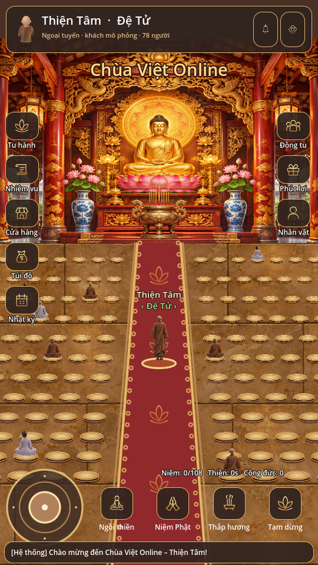

# Chùa Việt Online – Thiện Tâm

Dự án tiếp tục trong `ChuaVietOnline/` của AutoReviewCutter, nhánh `chua-viet-online`. Godot **4.3**, Android dọc 540×960, renderer Compatibility. Không cần dự án mới.



## Chạy

Mở `project.godot` bằng Godot 4.3 hoặc chạy:

```sh
godot --headless --path ChuaVietOnline --editor --quit
godot --path ChuaVietOnline
```

## Điều khiển và giao diện

- Joystick: kéo để di chuyển, hỗ trợ chạm trên Android và chuột trên máy tính.
- Chạm bồ đoàn trống: tự đi theo lối đến chỗ ngồi. Ngồi thiền: ngồi/đứng; bộ đếm thiền chỉ chạy khi đã ngồi.
- Niệm Phật: bắt đầu đếm chuỗi 108 hạt; Thắp hương: hiệu ứng và âm thanh; Tạm dừng: dừng tu tập và nhạc nền.
- Tu hành: các nghi thức, đọc văn bản kinh chú và cấu hình máy chủ WebSocket.
- Nhiệm vụ, Nhật ký, Phúc lợi: tiến trình thực trên thiết bị. Cài đặt: âm thanh, nhạc nền, kết nối. Nhân vật: áo nâu, áo xám, nhân vật nữ.
- Túi đồ và Cửa hàng: trang phục có sẵn và kho **sandbox**, không nhận tiền thật.

Chính điện dùng phối cảnh với 1.000 bồ đoàn có chỉ số ổn định. Mỗi khung hình chỉ vẽ các hàng gần nhân vật; di chuyển sẽ chuyển vùng quan sát. Tranh chính điện là nền trang trí; avatar, bồ đoàn, tên nhân vật và nút bấm là các lớp tương tác riêng.

`main.gd`: thế giới, di chuyển, chỗ ngồi, phối cảnh, lưu tiến trình. `temple_hud.gd`: giao diện và joystick. `practice_panel.gd`: nghi thức. `multiplayer.gd`: WebSocket. `art/`: tranh nền, sprite và biểu tượng.

## Multiplayer

```sh
cd ChuaVietOnline/realtime
npm ci
npm test
npm start
```

Trong Tu hành, nhập `ws://<IP-máy-tính>:8788` khi cùng mạng hoặc `wss://<máy-chủ>` khi triển khai HTTPS. Điện thoại không dùng localhost của máy tính. Máy chủ xác nhận độc quyền chỗ ngồi và giải phóng khi người chơi ngắt kết nối. Trạng thái trực tuyến chỉ bật sau gói welcome.

Ngoại tuyến có khách mô phỏng được ghi rõ trên giao diện. Không có máy chủ công cộng cấu hình sẵn; giới hạn 1.000 chỗ không đồng nghĩa đã kiểm thử tải 1.000 người.

## Kiểm thử và APK

```sh
godot --headless --path ChuaVietOnline --script res://tests/interaction_test.gd
```

Workflow `.github/workflows/chua-viet-online-apk.yml` kiểm thử, nhập dự án, chạy tương tác và xuất APK debug arm64. Đọc `RELEASE_CHECKLIST.md` trước phát hành.

Chưa bao gồm tài khoản đám mây, thanh toán thật, ghi âm tụng kinh thật hoặc kiểm thử thiết bị Android vật lý. Giọng đọc kinh dùng TTS tiếng Việt của thiết bị và văn bản do người dùng nhập.
